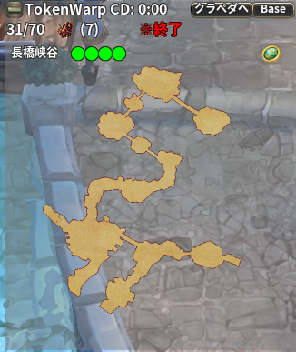
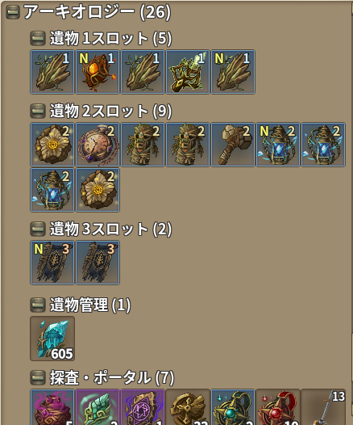

# Archeology Helper

> アーキオロジー用アドオン

| 項目 | 内容 |
| --- | --- |
| キー | `archeology_helper` |
| ソース | [archeology_helper.lua](archeology_helper.lua) |
| 設定画面 | あり（パネル左上の `＋`/`−` を右クリック） |

## 何をするアドオンか

アーキオロジー（考古学）の発掘は「遺物が**遠く／近く**にあるようです」という調査結果を頼りに探すため、
どこを調べたか分からなくなりがちです。素の全体マップにも調査の輪が出ますが、**直近 3 回ぶん**だけで、
マップを移ると消えます。

このアドオンは、調べた位置を**全体マップと同じ大きさの輪**でミニマップ上に記録し続け、
残りを絞り込めるようにします。あわせて**スタミナ錠の自動使用**と
**トークンワープでの対象マップ移動**も提供します。

## 使い方

ON にすると、画面上部に**対象マップのミニマップを並べたパネル**が出ます。
対象マップが 1 つの依頼（Lv530 以上の新しい依頼）では地図を大きく、3 つの依頼では 3 枚並べて出します。



| 要素 | 内容 |
| --- | --- |
| マップ名と `●●●●` | 発掘の進捗（緑が掘り終えた地点の数。新しい依頼は 4 地点） |
| ミニマップ | 調べた位置の輪。現在地は矢印、**今いるマップの敵は素のミニマップと同じ印**で表示。**行ったことのない所も含めたマップの全体図**を出す |
| 各マップ右上のトークンアイコン | クリックで**そのマップへトークンワープ**。使えないときは灰色 |
| `TokenWarp CD` | トークンワープの残りクールダウン |
| `n/70` | 依頼の試行回数と上限（上限は探査回数のオプションで増える） |
| アイテムアイコンと個数 | 依頼の受諾に使う**遺物探査許可証**の所持数。0 なら赤 |
| `※進行中` / `※終了` | 依頼の状態（全地点を掘ったか、試行回数を使い切ると終了） |
| `クラペダへ` ボタン | 依頼の NPC が居る**クラペダへ戻り、NPC の前へ移動する**。トークンワープは使わない（下の「クラペダへ戻る」） |
| `Base` ボタン | パネルを既定位置（`670, 70`）に戻す |
| 左上の `＋` / `−` | 左クリックで**折りたたみ／展開**、右クリックで**設定** |

パネルはドラッグで移動でき、位置は保存されます。

### 輪の読み方

調べるたびに、調べた位置を中心に輪を描きます。輪の大きさは素の全体マップと同じで、
**遺物は輪の線の近くにある**、という読み方です。中央の番号は何回目の調査かを表します。

色はチャットに出る調査結果（「遺物は〇〇にあるようです」）の距離の段階で変わります。

| 調査結果 | 色 |
| --- | --- |
| はるか遠く | 赤 |
| かなり遠く | 濃い橙 |
| 遠く | 橙 |
| 少し遠く | 金 |
| 近く | 黄 |
| かなり近く | 水色 |
| すぐ近く | 白 |

調査結果は**チャットの文言ではなくゲームから届く座標と距離**で拾うので、言語に関係なく動きます。

### クラペダへ戻る

依頼を受けられるのはクラペダの NPC だけです。トークンワープは次の対象マップへ飛ぶのに取っておきたいので、
`クラペダへ` ボタンは**トークンワープを使わず**、次の順に試します。

1. **クエストワープ**（設定で選んだクエスト。既定は「自動」で、使えるものを上から順に）

   | クエスト | 使えるとき |
   | --- | --- |
   | `91055`（`TOSHERO_TUTO_01`） | 受注可能（開始 NPC へ飛ぶ） |
   | `72165`（`MASTER_QUARRELSHOOTER1`） | 完了可能（完了 NPC へ飛ぶ） |

2. **クラペダ ワープスクロール**（ClassID `640073`。設定で OFF にできる）
3. どれも使えなければ `トークン以外でクラペダへ戻る方法がありません` と表示します。

クラペダに着くと、**依頼の NPC（考古学者アイリーネ）の前へ自動で移動します**。
既にクラペダに居るときに押すと、NPC の前へ移動だけします。設定で OFF にできます。

* 依頼のウィンドウは **NPC に話しかけたときにゲーム（サーバー）が開く**もので、アドオンからは開けません。
  NPC の前に着いたら、話しかけるのは手で行ってください。
* 押してから **60 秒以内**にクラペダへ着いたときだけ移動します。クエストワープの確認を断った後、
  別の手段でクラペダへ入ったときに勝手に動かないようにするためです。

### 依頼が終わったら

依頼の**最後の地点を見つけ、そのインスタンスダンジョンを終えてフィールドへ戻ったとき**に、
`再度依頼を受けにクラペダへ戻りますか？` と聞きます。地点を見つけた時点（ダンジョンに入る前）では聞きません。試行回数（`n/70`）の上限では聞きません。`はい` を押すと `クラペダへ` ボタンと同じ動きをします
（クラペダへ戻り、NPC の前へ移動）。

* 聞くのは**1 つの依頼につき 1 回**です。`いいえ` を押した後は、パネルの `クラペダへ` ボタンで戻ってください。
* 最後の地点を見つけていないときは、ログインやマップ移動で聞くことはありません。
* 最後の地点を見つけた後、ダンジョンに入らなかったときは聞きません。パネルの `クラペダへ` ボタンで戻ってください。
* 設定の「全地点を掘り終えたらクラペダへ戻るか聞く」で OFF にできます。

### 依頼を受けたら

依頼を受けると、**まだ掘り終えていない最初の対象マップへトークンワープします**。
確認はゲームのトークンワープの確認がそのまま出るので、`はい` で飛びます。
クールダウン中ならゲームの通知が出て飛びません。設定の「依頼を受けたら対象マップへトークンワープする」で OFF にできます。

### 遺物の展示スロット番号

インベントリの遺物の**右上に、その遺物を飾る展示のスロットの番号（1〜3）**を出します。
色は展示画面のスロットと同じです。

| 番号 | スロット |
| --- | --- |
| 1（水色） | 聖物と祭礼の遺物 |
| 2（金） | 生活と技術の遺物 |
| 3（橙） | 戦争と災難の遺物 |

番号は遺物の種類（`archeology_base_list` の `ExhibitSlotType`）で決まります。増幅用の遺物など、
展示スロットに入らないものには出ません。設定の「インベントリの遺物に展示スロットの番号を出す」で OFF にできます。

### 遺物の並べ替え

インベントリの遺物を次の順に並べ替えて表示します。

1. **レア度**の高い順（レア → マジック → ノーマル）
2. **1 つ目の効果**の種類（展示画面の効果一覧と同じ並び：考古学 → 戦闘 → 特殊、その中は展示画面の順）
3. その効果の**数値**の大きい順（同じなら 2 つ目以降の効果で比べる）

* 並べ替えるのは**見た目だけ**です。インベントリ上の実際の位置は変えません（サーバーへの通信はありません）。
  ゲームの「整理」やアイテムの出し入れで並びが戻ったときは、自動でまた並べ替えます。
* 検索欄に文字を入れている間は並べ替えません（ゲームが検索結果を詰めて並べるため）。
* 並べ替えた遺物をドラッグで入れ替えても意味はありません（次に並べ直したとき、この順へ戻ります）。
* 設定の「インベントリの遺物を レア度 → 効果 → 数値 の順に並べる」で OFF にできます。

### 遺物のセクション分け

インベントリの「遺物」を、**展示スロットごとのセクション**に分けて表示します。



| セクション | 入るもの |
| --- | --- |
| 遺物 1スロット (n) | 展示スロット 1（聖物と祭礼）の遺物 |
| 遺物 2スロット (n) | 展示スロット 2（生活と技術）の遺物 |
| 遺物 3スロット (n) | 展示スロット 3（戦争と災難）の遺物 |
| 遺物 その他 (n) | 展示スロットに入らないもの（増幅用の遺物・ボスの鍵など） |

* 元の「遺物 (n)」の区切りが「遺物 1スロット (n)」になり、その下に 2 / 3 / その他 が続きます。
* 見出しを押すと、ゲームの区切りと同じく畳む / 開くができます。畳んだ状態はそのセッションの間だけ覚え
  （ゲームの区切りと同じ）、インベントリが組み立て直されても保ちます。最後の祭壇を開いている間は、どれも開いて出します。
* 各セクションの中は「遺物の並べ替え」の順です（並べ替えを OFF にしているときは元の位置の順）。
* 並べ替えと同じく**見た目だけ**です。インベントリ上の実際の位置は変えません。
* 中身の無いセクション（2 / 3 / その他）は出しません。
* 設定の「インベントリの遺物を展示スロット(1 / 2 / 3)ごとのセクションに分ける」で OFF にできます。

### 最後の祭壇・探査ポータルの入場画面を開いている間はアーキオロジーだけ

最後の祭壇（展示画面）か探査ポータルの入場画面を開くと、インベントリを**「その他」タブへ切り替え、アーキオロジー以外のカテゴリを畳みます**
（インベントリに「アーキオロジー」のタブは無く、アーキオロジーの区分は「その他」タブの中にあるため）。
閉じると、切り替える前のタブと、畳んだカテゴリを元に戻します。
設定の「最後の祭壇・探査ポータルの入場画面を開いたら、インベントリをアーキオロジーだけにする」で OFF にできます。

### 探査ポータルの入場画面を「最近の設定」で開く

地点を見つけて開く探査ポータル（インスタンスダンジョン）の入場画面を、**前回入場したときの難易度とアイテムが入った状態で開きます**
（ゲームの「最近の設定」ボタンを開いた直後に押すのと同じ）。前回の設定が無いときは何もしません。
アイテムが足りず一部しか入らないときは、ゲームの通知がそのまま出ます。
設定の「探査ポータルの入場画面を「最近の設定」で開く」で OFF にできます。

### 遺物分解の数の表示を直す

遺物分解の窓の下（所持 / 獲得予定 / 分解後）が、ゲームの表示では `%s %s個` のまま出ます。
書式の文が翻訳辞書の ID のまま使われているためで、これを訳した文に置き換えて、**アイテム名と個数が出るように**します。
分解するときの確認の窓も同じく直ります。

### 遺物のツールチップの効果を折り返す

遺物のツールチップの「遺物効果」が長いと、ゲームの表示では 1 行に収まらず端で切れます
（例: 「探査ポータルクリア時、色褪せた記録の破片の追加獲得…」）。これを**折り返して全文を表示**します。

### 新しい遺物の NEW の印

**新しくインベントリに入った遺物**（街へ戻ったときの報酬の精算で届いたもの・鑑定したもの）の
**左上に黄色の `N`** を出し、どれが新しいものか分かるようにします。

* 印は**次の依頼を受けたとき**にまとめて消えます（鑑定 → 展示の入れ替え → 次の依頼、の 1 巡で見終わる想定）。
  展示・分解・売却などでインベントリから無くなった遺物の印も消えます。
* 新しいかどうかは、前に見た遺物の GUID の控え（キャラごと）と比べて決めます。
  入れたばかりのときは、今ある遺物を控えるだけで印は付けません。控えはインベントリから出た遺物も残すので、
  倉庫や取引から戻した遺物には付きません（2000 件を超えたら今ある遺物だけに戻します）。
* 祭壇を開いている間に入った遺物（展示から外して戻ったもの。戻るときに GUID が変わる）には付けません。
* 鑑定は同じ遺物に効果を足していくので、何段階か鑑定しても印は 1 つです。
* 設定の「新しく入った遺物に NEW の印(N)を付ける」で OFF にできます。

### 祭壇ランク上昇

展示画面の `祭壇ランク上昇` を押したときの**使用数を、使える最大数で始めます**（ゲームは 1 で始まります）。
最大数はゲームと同じく、所持している発掘コインの数と、次のランクまでに必要な経験値の小さいほうです。

## 設定

パネル左上の `＋` / `−` を**右クリック**すると開きます。


| 項目 | 既定値 | 説明 |
| --- | --- | --- |
| チェックするとスタミナ錠自動使用（設定はキャラ毎） | OFF | スタミナが 1 以下になると**スタミナ錠（ClassID `640009`）を自動使用**する |
| 「クラペダへ」で使うクエストワープ | 自動 | 自動（使えるものを順に）/ 各クエスト / 使わない |
| クエストワープが使えないときはクラペダ ワープスクロールを使う | ON | OFF にするとスクロールを使わない |
| クラペダに着いたら依頼の NPC(アイリーネ)の前へ移動する | ON | OFF にすると、これまでどおりクラペダへ戻るだけ |
| 全地点を掘り終えたらクラペダへ戻るか聞く | ON | OFF にすると聞かない（「依頼が終わったら」の節） |
| 依頼を受けたら対象マップへトークンワープする | ON | OFF にすると飛ばない（「依頼を受けたら」の節） |
| インベントリの遺物に展示スロットの番号を出す | ON | OFF にすると番号を出さない（「遺物の展示スロット番号」の節） |
| インベントリの遺物を レア度 → 効果 → 数値 の順に並べる | ON | OFF にするとゲームの並びのまま（「遺物の並べ替え」の節） |
| 新しく入った遺物に NEW の印(N)を付ける | ON | OFF にすると印を出さない（「新しい遺物の NEW の印」の節） |
| インベントリの遺物を展示スロット(1 / 2 / 3)ごとのセクションに分ける | ON | OFF にすると「遺物」1 つのまま（「遺物のセクション分け」の節） |
| 探査ポータルの入場画面を「最近の設定」で開く | ON | OFF にするとゲームのまま空で開く（「探査ポータルの入場画面を「最近の設定」で開く」の節） |
| 最後の祭壇・探査ポータルの入場画面を開いたら、インベントリをアーキオロジーだけにする | ON | OFF にするとインベントリはそのまま（「最後の祭壇・探査ポータルの入場画面を開いている間はアーキオロジーだけ」の節） |
| 地図に敵を表示する | ON | 今いる対象マップの地図に、視界内の敵を素のミニマップと同じ印で出す |

ON にしていると、街に入ったときにスタミナ錠が **10 個以下**なら
`スタミナ錠が残り少ないです` と通知します。

## しくみ

* 依頼の受諾（`ARCHEOLOGY_MISSION_ACCEPT_RESULT` が `SUCCESS`）で記録をリセットします。
* 遺物のスロット番号は、素の `INV_ICON_SETINFO`（インベントリの 1 スロットにアイテムを置く関数）の後に足しています。
  ClassName が `Arc_` で始まらないアイテムはすぐ抜けます。
  ログイン時のインベントリはこの初期化より前に組み立てられるので、掛けた直後に一度描き直します。
* 遺物の並べ替えは、インベントリの組み立て直し（素の `INSERT_ITEM_TO_TREE` が元の「遺物」の区切りを作ったとき）と
  `INV_ITEM_ADD` / `INV_ITEM_REMOVE` の 0.3 秒後に、遺物の入る slotset のスロットへ並べ替えた順に置き直します
  （素が検索中に行うのと同じ置き方）。効果の並びの重みは素の展示画面（`archeology_exhibition.lua`）の local を写しています。
* セクションは、元の「遺物」の区切りを 1 スロットとして使い、2 / 3 / その他を素がカテゴリの中の区切りを作る
  `MAKE_INVEN_SLOTSET` / `MAKE_INVEN_SLOTSET_NAME` で足します（名前は元の区切り + `_aoh<番号>`）。
  インベントリの区切りは足した順に並ぶだけなので、素が組み立て直す途中で元の「遺物」の区切りを作った直後
  （`INSERT_ITEM_TO_TREE`）に足し、「遺物管理」などより上に来るようにしています。空のセクションは見出しごと
  高さ 0 にして見せません。どの区切りも中身の行数ぶんの高さへ作り直します
  （空のスロットを隠すだけでは行の高さが残るため）。組み立て直し（`tree:Clear`）で消えるので、そのたびに作り直します。
  素が 1 個足すとき（`INSERT_ITEM_TO_TREE`）に位置のスロットが無ければ、足す前に行を増やします。
* クラペダへ戻るかは、**ゲームの記録（アカウントの `archeology_map_<n>_complete`。素の全体マップも見ているもの）**で
  依頼が終わったかを決めます。ダンジョンの結果（`ARCHEOLOGY_PORTAL_TRACKER_RESULT`）が届いたら `end_result` にマップ名を控え、
  （最後の地点のダンジョンでは結果が届かず表示が閉じるだけなので、閉じた時点で完了になっていればそこで控え、）
  フィールドへ戻ったとき（マップの読み込み、または同じマップでレイヤー 0 に戻って結果の表示が閉じたとき）に、
  全ての対象マップが完了になっていれば聞きます（記録が遅れて届くことがあるので、控えを立ててから 4 秒までは 1 秒おきに見直します）。
  途中のダンジョンなら控えを消して聞きません。聞いたかどうかは `end_asked` に持ち、次の依頼の受諾で下ろします。
  地点に触れた回数では決めません（1 つの地点で何度も数えてしまい、途中で聞いてしまったため）。
* 調査結果は `ARCHE_SEARCH_RESULT` で受け取ります（素の全体マップが輪を描くのと同じメッセージ）。
  **調査の対象の地点が変わったら**、前の地点を探した輪は消します。
* `TARGETSPACE_PRECHECK` で発掘ポイント（`ActorType` `155003`）に触れたことを検出し、
  そのマップの発掘数を +1 して、マップの輪をクリアします。
* 対象マップすべてで全地点を掘ると `全てのMAPの発掘が完了しました` と表示し、記録をリセットします。
* 対象マップ・地点の数・試行回数の上限は、素の `shared_archeology` から引きます。
* 敵は `MON_MINIMAP` / `MON_MINIMAP_END` で受け取ります（素のミニマップと同じメッセージ）。0.5 秒ごとに位置を追い、居なくなった敵は消します。
* スタミナ自動使用は 2 秒間隔でチェックし、**使用は 10 秒に 1 回まで**に制限しています。
* 地図は霧の掛かっていない全体図を `world.PreloadMinimap` で読み込んで出します。読み込みが間に合わないときは、踏破した所だけの図を仮に出して、読み込めたら差し替えます。

## 保存先

`../addons/_nexus_addons_p/<アカウントID>/archeology_helper.json`

```json
{
  "count": 0,
  "is_archeology": false,
  "marker_ver": 2,
  "map_info": { "<マップ名>": { "get_count": 0, "target_key": "...",
    "markers": [ { "wx": 0, "wz": 0, "draw": 1500, "color": "FFFFA500", "count": 1 } ] } },
  "x": 670, "y": 70,
  "<CID>": { "sta_check": 0 }
}
```

輪はワールド座標で保存されるので、**ログアウトしてもマップを移っても探索の記録は残ります**。
2026-10 の刷新より前の形式の記録は読み込み時に捨てます。

## 注意

* 対象マップは**アカウント側のプロパティ**（`archeology_map_1`〜`3`）から取得します。
  依頼を受けていないと空のパネルになります。
* 発掘ポイントに触れると、そのマップの輪は**すべて消えます**（次の地点を探し直すため）。
* 本家 Nexus Addons など、同名の旧初期化関数（`ARCHEOLOGY_HELPER_ON_INIT`）を持つ
  アドオンが読み込まれている場合は、競合を避けるため初期化をスキップします。
