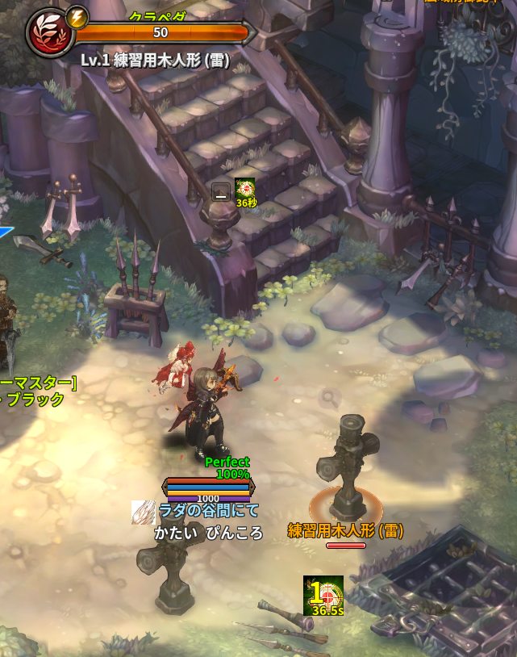
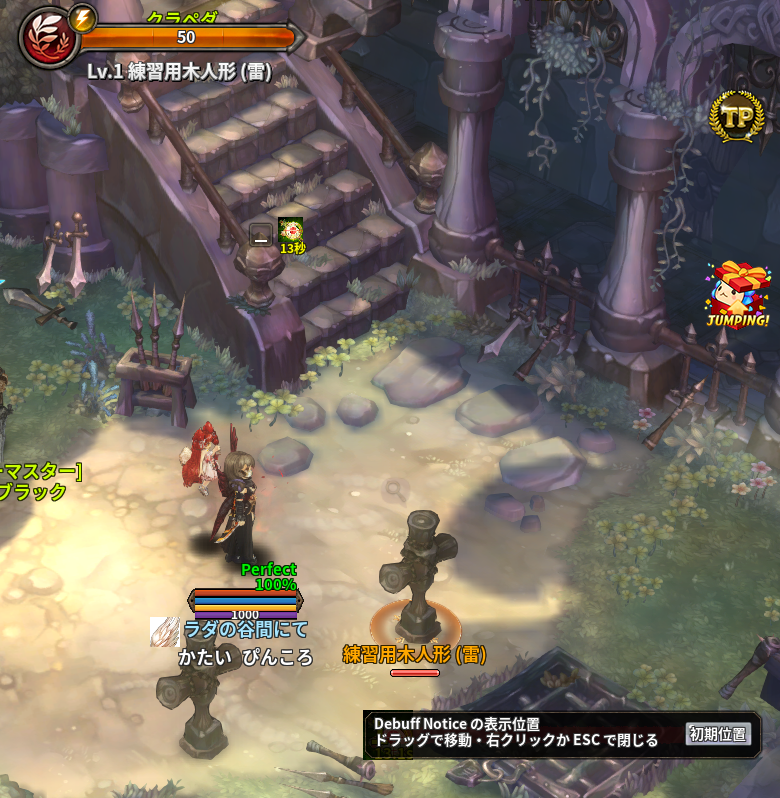

# Debuff Notice

> 自分が与えたデバフを見やすく表示

| 項目 | 内容 |
| --- | --- |
| キー | `debuff_notice` |
| ソース | [debuff_notice.lua](debuff_notice.lua) |
| 設定画面 | 位置合わせの窓（アドオン一覧の歯車ボタン） |

## 使い方

ON にするだけです。ボスに**自分がかけたデバフ**が、ターゲットバフ欄の下に
大きめのアイコン（50×50）で並びます。各アイコンには

* 左下に**残り時間**（`3.5s` 形式・黄色）
* 上に**重複数**（`over` が 1 以上のときのみ・黄色の大きい数字）

が重なって表示され、アイコンにマウスを乗せると通常のバフツールチップが出ます。

他人がかけたデバフは表示しません。**自分の効果だけ**を追えるのが目的です。

### 表示位置を動かす

表示そのものは掴めません（デバフが無いときは大きさ 0 で、出るのもボス戦の最中だけのため）。
アドオン一覧の**歯車ボタン**を押すと、表示と同じ大きさ（8 個分）の位置合わせの窓が出ます。

* **ドラッグ**して置きたい場所へ動かすと、その位置が保存されます。街の中でも動かせます。
* **「初期位置」**ボタンで、元の位置（ターゲットのバフ欄の下）へ戻ります。
* **右クリック**か **ESC** で窓を閉じます。

## しくみ

* `COMMON_BUFF_MSG`（旧クライアント向けに `COMMON_BUFF_MSG_OLD` があればそちら）をフックし、
  バフの `ADD` / `UPDATE` / `REMOVE` / `CLEAR` を拾います。
* 表示対象に残すのは次をすべて満たすものだけです。
  * バフクラスの `Group1` が `Debuff`（または綴り違いの `Deuff`）で、`ShowIcon` が `FALSE` でない
  * アイコン名が `icon_None` でない
  * **かけた本人が自分**（`buff:GetHandle() == session.GetMyHandle()`）
  * 対象モンスターの `MonRank` が **`Boss`**
* 並び順は `buff_index` の昇順で、最大 8 枠（`slotset` 8×1）。
  表示するデバフが無いときはフレームを 0×0 に潰すので、画面には何も出ません。
* 0.1 秒間隔の更新で残り時間と重複数を書き換え、バフが消えていたら枠から外します。
* 対象が居なくなった（`world.GetActor` が nil）場合もフレームを 0×0 に潰します。

## 保存先

専用のファイルはありません。ON/OFF と表示位置（`x` / `y`。両方 0 なら初期位置）は
`../addons/_nexus_addons_p/<アカウントID>/settings.json` の `debuff_notice` に入ります。

## 注意

* **街（`City`）では動きません。**ただし例外として `c_highlander`（ハイランダーの街）だけは動作し、
  そこでは**ボス以外のモンスター**のデバフも表示します（練習用マップとして扱っているため）。
* 動かしていないときの表示位置は `targetbuff` フレーム基準（右へ 100・下へ高さ+50）です。
* 同時に表示できるのは 8 個までです。
