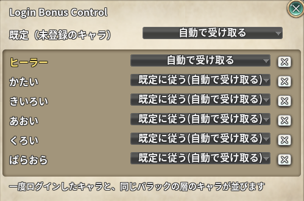

# Login Bonus Control

> ログインボーナス（出席報酬確認）の画面を、キャラごとに「表示する / 表示しない / 自動で受け取る」から選びます

| 項目 | 内容 |
| --- | --- |
| キー | `login_bonus_control` |
| ソース | [login_bonus_control.lua](login_bonus_control.lua) |
| 設定画面 | あり（アドオン一覧の歯車ボタン / Addons Menu） |

## 使い方

アドオンを ON にして、歯車ボタンから設定画面を開きます。

| 項目 | 動作 |
| --- | --- |
| **既定（未登録のキャラ）** | 一覧に無いキャラと、「既定に従う」にしたキャラがどう動くか。**初期値は「表示する」**（今までどおり） |
| **キャラの行** | キャラごとに「既定に従う / 表示する / 表示しない / 自動で受け取る」を選ぶ。初期値は「既定に従う」 |
| **×** | 一覧からキャラを消す（削除したキャラの片付け用） |



| モード | ログインしたとき |
| --- | --- |
| 表示する | 素のまま。受け取っていない報酬があれば出席チェックの一覧が開く |
| 表示しない | 一覧を開かない。**受け取りもしない**ので、受け取るときはシステムメニューのカレンダーボタンから開く |
| 自動で受け取る | 一覧を開かずに、開催中の出席チェックを順に受け取る。受け取った報酬の名前をチャットに出し、出席表の画面は開かない |

一覧には、**一度ログインしたキャラ**と、**今のキャラと同じバラックの層に居るキャラ**が並びます（今のキャラは黄色）。
並びはバラックと同じ順（層 → 層の中の順番）です。層や順番がまだ分からないキャラは後ろに並びます。
名前はログインのたびに書き直すので、改名しても設定はそのまま残ります。

## しくみ

* 受け取っていない報酬があるとサーバーから `ATTENDANCE_REWARD_CHECK_UI_ON` が届き、素がそこで一覧を開きます。
  その素の関数を置換方式で掴み、今のキャラのモードで分けます（「表示する」なら素をそのまま呼びます）。
* 自動で受け取るときは、素の一覧と同じ条件（`GetAttendanceData` と `CHECK_ATTENDANCE_VALID`）で並べた出席チェックごとに、
  素の `ATTENDANCE_GIVE_REWARD` を 0.5 秒ずつ空けて呼びます。「今日もう受け取ったか」の判定は素に任せています。
* 実際に要求が飛んだかは `AttendanceRewardClick` で拾い、その ID の出席表（`ON_ATTENDANCE_RESULT`）だけを開かずにチャットで知らせます。
  カレンダーボタンから手で開いたときは素のままです。
* ゲームを起動して最初のキャラでは、この通知がアドオンの初期化より先に届きます。そのため読み込みの時点でもフックを掛け、
  設定がまだ読まれていなければ `settings.json` を直に読んで ON / OFF を判定します。
* 統合サーバーでは素も一覧を出さないので、何もしません。

## 保存先

`../addons/_nexus_addons_p/<アカウントID>/login_bonus_control.json`

```json
{
  "default_mode": "show",
  "chars": {
    "cid_123456789": { "name": "キャラ名", "mode": "default", "layer": 1, "order": 0 }
  }
}
```

`mode` は `default` / `show` / `hide` / `auto`、`default_mode` は `show` / `hide` / `auto`。
`layer` / `order` は一覧をバラック順に並べるための控えです（分かったときにだけ入ります）。
アドオンが OFF のままならファイルは作られません。

## 注意

* 出席チェックはチーム（アカウント）単位のものが多いので、どのキャラで受け取っても同じ報酬です。
  「このキャラで受け取る」と決めておき、他のキャラは「表示しない」にする使い方を想定しています。
