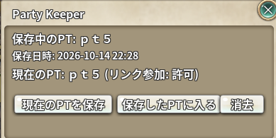

# Party Keeper

> 今入っている PT を保存しておき、後から同じ PT へ入り直します

| 項目 | 内容 |
| --- | --- |
| キー | `party_keeper` |
| ソース | [party_keeper.lua](party_keeper.lua) |
| 設定画面 | あり（アドオン一覧の歯車ボタン / Addons Menu） |

## 使い方

アドオン一覧の歯車ボタンから窓を開きます（Addons Menu のショートカットにも出せます）。

| ボタン | 動作 |
| --- | --- |
| **現在のPTを保存** | 今入っている PT の ID と名前を保存する（上書き）。PT に入っていなければ `NotBelongsToParty` の文言が出る |
| **保存したPTに入る** | 保存した PT へ入る。チャットの PT リンクを押したときと同じ動き |
| **消去** | 保存した PT を消す |

窓には、保存している PT の名前と保存日時、今の PT の名前と**リンク参加の許可**が出ます。



### 入り直せる条件

入れるかどうかはサーバーが決めます。次の両方を満たしている必要があります。

* **その PT がまだ残っている**（全員が抜けて解散していると入れません）
* **PT のリンク参加が許可されている**

リンク参加は、リーダーが PT 窓の「PT リンクを貼る」ボタンを押すと許可になります。
Party Keeper では、**リーダーが保存したときは同じように許可へ上げます**。
リーダー以外が保存したときは上げられないので、許可されていなければその旨を表示します。

PT に入っている間は入り直せません（素の PT リンクを押したときと同じ文言 `HadMyPartySame` / `HadMyPartyOther` が出ます）。

## しくみ

* 保存するのは `session.party.GetPartyInfo()` の `info:GetPartyID()` と `info.name` です。
* 入り直しは素の `SLP`（チャットの PT リンク）と同じ `party.JoinPartyByLink(PARTY_NORMAL, PT ID)` を呼びます。
* **同じ ID の PT を作り直すことはできません。** PT ID はサーバーが払い出すもので、
  PT を作る素の API（`party.ReqPartyMake`）は名前しか受け取りません。

## 保存先

`../addons/_nexus_addons_p/<アカウントID>/party_keeper.json`

```json
{ "party_id": "", "name": "", "saved_at": "" }
```

PT はキャラではなくチーム単位なので、アカウント単位で 1 件だけ持ちます。

## 注意

* 保存できる PT は 1 件だけです。保存し直すと上書きされます。
* 入れなかったときの文言はサーバーから届くもので、Party Keeper では出していません。
